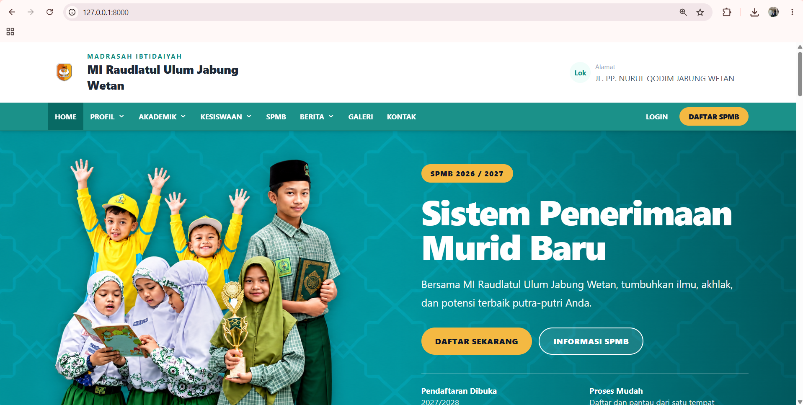

# Website Profil Madrasah + Sistem SPMB Online

## Deskripsi

Aplikasi Laravel untuk mengelola website profil madrasah dan Sistem Penerimaan Murid Baru (SPMB) online. Konten website dikelola melalui dashboard admin, sedangkan calon murid dapat mendaftar, mengisi formulir, mengunggah berkas, dan memantau status pendaftaran.

Dokumentasi ini mengikuti implementasi dalam repository. Data madrasah yang tersedia belum seluruhnya terverifikasi sebagai data resmi.

## Tujuan Project

- Menyediakan informasi madrasah yang dapat diperbarui melalui CMS.
- Memudahkan pendaftaran murid baru dan pengumpulan dokumen.
- Membantu admin melakukan verifikasi, meminta revisi, dan menetapkan hasil pendaftaran.
- Menyediakan bukti pendaftaran PDF, verifikasi QR Code, serta laporan CSV.

## Fitur Utama

- Profil madrasah, guru, program unggulan, prestasi, dan ekstrakurikuler.
- Hero/Banner CMS dengan banner gabungan desktop dan banner mobile opsional.
- Kegiatan siswa beserta galeri, berita, pengumuman, dan album galeri.
- Kontak, media sosial, serta pengaturan identitas website.
- Registrasi dan login pendaftar, formulir SPMB, dan unggah dokumen.
- Verifikasi, revisi, penerimaan/penolakan, dan riwayat status.
- Bukti PDF, QR Code, laporan, serta export CSV.
- Pengelolaan periode, gelombang SPMB, dan akun admin.

## Website Publik

| Halaman | Alamat |
| --- | --- |
| Homepage | / |
| Profil, sejarah, visi-misi, sambutan | /profil, /profil/sejarah, /profil/visi-misi, /profil/sambutan |
| Guru | /guru |
| Program unggulan | /program-unggulan |
| Prestasi | /prestasi |
| Ekstrakurikuler | /ekstrakurikuler |
| Kegiatan siswa dan detail | /kegiatan, /kegiatan/{slug} |
| Berita dan detail | /berita, /berita/{slug} |
| Pengumuman | /pengumuman |
| Galeri dan album | /galeri, /galeri/{slug} |
| Kontak | /kontak |
| Verifikasi bukti SPMB | /verifikasi-spmb/{token} |

Berita dan kegiatan ditampilkan sesuai status serta waktu publikasinya. Tautan media sosial aktif ditampilkan melalui data CMS. Halaman struktur organisasi masih berupa kondisi data kosong; halaman kurikulum masih berupa informasi statis yang perlu diverifikasi.

Hero mengambil data database. Banner gabungan memuat desain latar dan ilustrasi dalam satu gambar; judul, tahun pelajaran, deskripsi, serta tombol tetap dikelola sebagai teks melalui CMS. Rekomendasi desain desktop 1920 × 720 piksel dan mobile 768 × 960 piksel. Sisakan ruang teks di kanan pada desktop dan di bawah pada mobile. Tampilan responsif dapat memotong bagian tepi gambar.

## Sistem SPMB

1. Pendaftar membuat akun di /register dan masuk melalui /login.
2. Mengisi biodata di /dashboard/biodata dan data orang tua di /dashboard/orang-tua.
3. Mengunggah berkas di /dashboard/dokumen.
4. Memeriksa data di /dashboard/review dan mengirim pendaftaran.
5. Memantau hasil dan catatan admin di /dashboard/status.
6. Memperbaiki data ketika diminta revisi, lalu mengirim ulang.
7. Melihat dan mengunduh bukti pendaftaran PDF dengan QR Code.

Dokumen wajib meliputi foto calon murid, kartu keluarga, dan akta kelahiran. Dokumen tambahan tersedia untuk KTP orang tua, ijazah TK, serta dokumen pendukung. Foto menerima JPG/JPEG/PNG; dokumen lainnya menerima PDF/JPG/JPEG/PNG, maksimal 2 MB per berkas.

Status yang digunakan: draft, submitted, under_review, revision, verified, accepted, dan rejected. Pendaftar dapat mengubah data ketika draft atau revisi. Admin memberikan catatan untuk revisi atau penolakan.

Pengiriman pendaftaran memerlukan periode dan gelombang aktif yang sesuai tanggal pendaftaran. Kuota dapat dicatat melalui admin; jangan menganggapnya sebagai penerimaan otomatis atau pembatasan kuota otomatis.

## Dashboard Admin

Masuk melalui /login menggunakan akun admin aktif, kemudian akses /admin.

- Ringkasan jumlah pendaftar, pendaftaran menunggu verifikasi, diterima, berita, kegiatan, guru, serta album galeri.
- Daftar pendaftar dan pengelolaan status, catatan, dokumen, serta PDF.
- CMS profil madrasah, guru, program, prestasi, ekstrakurikuler, berita, pengumuman, dan galeri.
- CMS kegiatan siswa dengan unggah banyak gambar, caption, urutan, serta gambar sampul.
- Hero/Banner di /admin/hero: teks, tahun pelajaran, tombol, status aktif, banner desktop, dan mobile opsional.
- Unggah hero JPG/JPEG/PNG/WEBP maksimal 2 MB per gambar, disimpan menggunakan nama unik pada storage/app/public/hero/.
- Pengelolaan kontak, media sosial, logo, favicon, identitas, footer, dan warna website.
- Pengelolaan periode serta gelombang melalui /admin/spmb/periode dan /admin/spmb/gelombang.
- Laporan dan export CSV melalui /admin/spmb/laporan.
- Manajemen akun admin melalui /admin/pengguna, khusus super admin.

Banner desktop digunakan sebagai fallback jika banner mobile belum diunggah. Perubahan konten yang disimpan dibaca kembali oleh homepage.

## Role Pengguna

| Role | Hak akses |
| --- | --- |
| super_admin | Seluruh modul admin, termasuk membuat, mengubah, menonaktifkan akun admin dan mereset passwordnya. |
| admin | Mengelola konten website, pendaftaran, periode, gelombang, dan laporan; tidak mengakses manajemen akun admin. |
| pendaftar | Mengelola pendaftaran sendiri, dokumen, status, serta bukti pendaftaran. |

Pengunjung tanpa login dapat membuka website publik dan halaman verifikasi QR. Akun admin/super admin yang tidak aktif ditolak saat login dan mengakses area admin.

## Teknologi yang Digunakan

- PHP dan Laravel 9; persyaratan PHP pada composer.json adalah ^8.0.2.
- Blade, Tailwind CSS 3, Alpine.js 3, dan Vite 4.
- MySQL/MariaDB untuk database aplikasi.
- Laravel session authentication dan middleware role.
- Laravel Dompdf untuk PDF dan Simple QRCode untuk QR Code.
- PHPUnit 9 untuk pengujian.
- Composer serta npm untuk dependensi.

Gunakan versi dependensi dari composer.lock dan package-lock.json. Catatan keamanan versi dependensi tersedia pada bagian Status Project.

## Persyaratan Sistem

- PHP yang memenuhi composer.json beserta Composer.
- Ekstensi PHP Laravel dan pengolahan berkas: Ctype, cURL, DOM/XML, Fileinfo, GD, Mbstring, OpenSSL, PDO, dan Tokenizer.
- Driver PDO MySQL untuk aplikasi; PDO SQLite untuk pengujian berbasis database in-memory.
- MySQL/MariaDB serta akses membuat atau menggunakan database.
- Node.js dan npm yang kompatibel dengan Vite 4.
- Direktori storage/ dan bootstrap/cache/ dapat ditulis oleh proses aplikasi.
- Document root web server mengarah ke public/.

Lingkungan pengembangan sebelumnya menggunakan PHP 8.0.30 dan Node.js 22.16.0. Versi tersebut merupakan catatan lingkungan pengujian, bukan pernyataan kelayakan keamanan untuk production.

## Instalasi Project

Gunakan repository yang sudah ada, lalu jalankan dari direktori yang berisi file artisan. Tidak perlu membuat project Laravel baru.

```powershell
composer install
npm ci
```

Jika .env belum ada, salin contoh konfigurasi. Jangan menimpa .env instalasi yang sudah berjalan.

```powershell
Copy-Item .env.example .env
```

Setelah mengisi .env, buat application key hanya untuk instalasi baru:

```powershell
php artisan key:generate
```

Jangan mengganti APP_KEY pada instalasi existing karena dapat memengaruhi data terenkripsi dan sesi. Lanjutkan dengan konfigurasi database, migration, seeder yang sesuai, serta storage link di bawah.

## Konfigurasi .env

Contoh untuk pengembangan lokal; sesuaikan kredensial database dengan lingkungan masing-masing:

```dotenv
APP_NAME="Website Profil Madrasah + Sistem SPMB Online"
APP_ENV=local
APP_KEY=
APP_DEBUG=true
APP_URL=http://127.0.0.1:8000

DB_CONNECTION=mysql
DB_HOST=127.0.0.1
DB_PORT=3306
DB_DATABASE=web_profil_miru
DB_USERNAME=root
DB_PASSWORD=

FILESYSTEM_DISK=local
QUEUE_CONNECTION=sync
SESSION_DRIVER=file
CACHE_DRIVER=file
MAIL_MAILER=log
```

APP_KEY diisi oleh perintah key:generate. Unggahan modul menggunakan disk public secara eksplisit meskipun default FILESYSTEM_DISK adalah local. MAIL_MAILER=log cocok untuk pemeriksaan email lokal.

Untuk bootstrap super admin tanpa data demo, ProductionSeeder membaca variabel berikut. Isi sendiri melalui .env lokal server; password sengaja tidak dicantumkan.

```dotenv
SCHOOL_NAME="Nama Madrasah"
INITIAL_SUPER_ADMIN_NAME=
INITIAL_SUPER_ADMIN_EMAIL=
INITIAL_SUPER_ADMIN_PASSWORD=
```

Nama wajib diisi, email harus valid dan unik, serta password minimal 12 karakter. Variabel akun hanya dibutuhkan jika belum ada super admin. Hapus rahasia bootstrap dari konfigurasi setelah akun berhasil dibuat.

Untuk production, gunakan APP_ENV=production, APP_DEBUG=false, APP_URL domain HTTPS sebenarnya, dan kredensial server yang sesuai. Jangan commit .env atau rahasia ke repository.

## Setup Database

Buat database kosong jika belum tersedia, misalnya melalui klien MySQL:

```sql
CREATE DATABASE web_profil_miru
    CHARACTER SET utf8mb4
    COLLATE utf8mb4_unicode_ci;
```

Sesuaikan DB_DATABASE, DB_USERNAME, dan DB_PASSWORD pada .env. Untuk database existing, gunakan database tersebut dan lakukan backup sebelum perubahan skema.

Seeder default memanggil ProductionSeeder, yang membuat profil minimal dan super admin awal tanpa memasukkan konten demo:

```powershell
php artisan db:seed
```

Jalankan setelah migration. Alternatif eksplisit yang setara:

```powershell
php artisan db:seed --class=ProductionSeeder
```

Seeder tidak mengganti kredensial super admin yang sudah ada.

Untuk development lokal yang membutuhkan contoh konten dan akun, gunakan pilihan berikut setelah migration:

```powershell
php artisan db:seed --class=DevelopmentSeeder
```

**DEVELOPMENT ONLY — jangan gunakan akun berikut untuk production.**

| Role | Email | Password development |
| --- | --- | --- |
| Super admin | superadmin@mi-ru.test | spmb-dev-2026 |
| Admin | admin@mi-ru.test | spmb-dev-2026 |

Akun tersebut hanya tersedia jika DevelopmentSeeder dijalankan. Seeder menggunakan firstOrCreate sehingga password akun existing tidak ditimpa. DevelopmentSeeder hanya berjalan pada lingkungan local/testing.

Periode dan gelombang demo dibuat tidak aktif. Atur tanggal dan aktifkan melalui admin sebelum mencoba pengiriman pendaftaran.

## Migration

Jalankan migration tambahan tanpa menghapus data:

```powershell
php artisan migrate
php artisan migrate:status
```

Migration mencakup tabel konten CMS, hero/banner, pengguna, pendaftaran, dokumen, periode, dan gelombang. Jangan menggunakan migrate:fresh, db:wipe, atau reset database pada instalasi existing.

## Storage Link

Hubungkan penyimpanan publik agar gambar dan unggahan dapat diakses:

```powershell
php artisan storage:link
```

Tautan public/storage mengarah ke storage/app/public. Jika tautan sudah tersedia, tidak perlu membuat ulang. Pastikan APP_URL sesuai alamat aplikasi dan direktori penyimpanan dapat ditulis.

## Menjalankan Vite

Jalankan pada terminal terpisah selama pengembangan:

```powershell
npm run dev
```

Untuk menghasilkan aset build:

```powershell
npm run build
```

Akses website melalui alamat Laravel. Server Vite menyediakan aset saat pengembangan; hasil build tersimpan di public/build/.

## Menjalankan Laravel

```powershell
php artisan serve
```

Alamat default:

- Website publik: http://127.0.0.1:8000
- Login: http://127.0.0.1:8000/login
- Dashboard admin: http://127.0.0.1:8000/admin
- Dashboard pendaftar: http://127.0.0.1:8000/dashboard

Gunakan dua terminal untuk Laravel dan Vite. Jika menggunakan port berbeda, sesuaikan APP_URL.

## Testing

Jalankan pengujian aplikasi:

```powershell
php artisan test
```

Contoh menjalankan pengujian modul tertentu:

```powershell
php artisan test --filter=HeroBannerTest
php artisan test --filter=SpmbRegressionTest
php artisan test --filter=SchoolDataFinalizationTest
```

Pengujian fitur mencakup CMS, hero, kegiatan, kontak/media sosial, seeder, alur SPMB, PDF, QR Code, serta export. Pengujian fitur utama menggunakan SQLite in-memory; smoke test bawaan dapat mengakses database dari konfigurasi lingkungan. Gunakan lingkungan pengujian/development terpisah, bukan database production.

Pemeriksaan route dan aset:

```powershell
php artisan route:list
npm run build
```

Uji manual mencakup login sesuai role, perubahan konten CMS lalu pemeriksaan homepage, unggah berkas, pengiriman pendaftaran, revisi, verifikasi, hasil diterima/ditolak, unduh PDF, pemindaian QR, dan export CSV. Gunakan data uji, periode aktif, dan gelombang yang sesuai tanggal pengujian.

## Struktur Folder Singkat

```text
app/
  Http/Controllers/     Controller publik, autentikasi, pendaftar, dan admin
  Http/Middleware/      Pembatasan akses termasuk role
  Models/               Model CMS dan SPMB
database/
  migrations/           Perubahan skema database
  seeders/              Bootstrap minimal dan data demo terpisah
docs/                   Audit, checklist, dan dokumentasi pendukung
public/                 Document root serta aset publik
resources/
  views/                Blade publik, admin, dan dashboard pendaftar
  css/                  Stylesheet
  js/                   JavaScript
routes/web.php          Route aplikasi
storage/app/public/     Penyimpanan unggahan
tests/Feature/          Pengujian fitur
```

## Status Project

Modul utama website publik, CMS, dan SPMB sudah diimplementasikan. Finalisasi data resmi, peninjauan konfigurasi server, dan penyelesaian temuan keamanan dependensi tetap diperlukan sebelum penggunaan production.

Halaman struktur organisasi belum memiliki data resmi; informasi kurikulum masih statis. Jangan menganggap halaman tersebut sebagai modul CMS lengkap.

Lihat [catatan audit dan peningkatan dependensi](docs/SECURITY_DEPENDENCY_UPGRADE_2026-10-19.md) untuk temuan yang masih perlu ditangani pada stack PHP/Laravel existing. Dokumentasi ini tidak menyatakan aplikasi sudah lolos audit keamanan production.

## Catatan Data Demo dan Data Resmi

Belum ada sumber data resmi madrasah yang diberikan untuk finalisasi. Nama, kontak, alamat, profil, guru, prestasi, jadwal, dan konten existing harus diperiksa pemilik madrasah sebelum dinyatakan resmi.

- Data demo hanya untuk pengembangan dan pengujian.
- Seeder default tidak memasukkan konten demo; DevelopmentSeeder merupakan pilihan terpisah.
- Record existing dipertahankan; jangan menghapusnya otomatis hanya karena belum terverifikasi.
- Beberapa placeholder disaring dari tampilan publik, tetapi penyaringan tersebut tidak menggantikan pemeriksaan data resmi.
- Tinjau dan ganti konten melalui CMS berdasarkan dokumen resmi yang disetujui.

Gunakan [checklist data sekolah](docs/DATA_SEKOLAH_CHECKLIST.md) dan [audit data sekolah](docs/AUDIT_DATA_SEKOLAH.md) sebagai panduan finalisasi.

## Screenshot

Path berikut disiapkan untuk dokumentasi. Gambar belum ditambahkan; tambahkan screenshot aktual setelah tersedia, tanpa menyertakan data pribadi pendaftar.

### Homepage



### Dashboard Admin


### Dashboard Pendaftar


### Halaman SPMB


## Author / Pengembang

Nama pengembang belum dicantumkan. Lengkapi bagian ini dengan nama dan kontak pengembang yang telah disetujui untuk dipublikasikan.