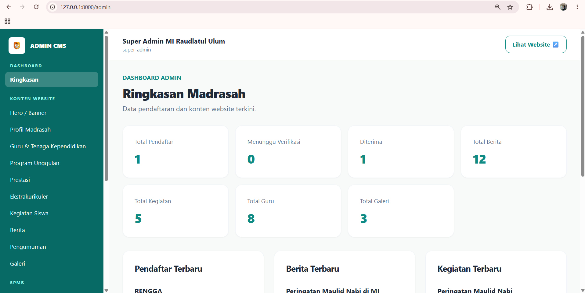
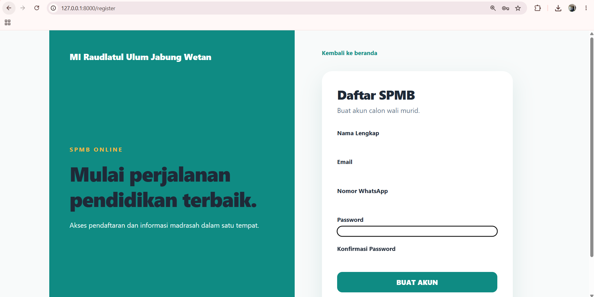
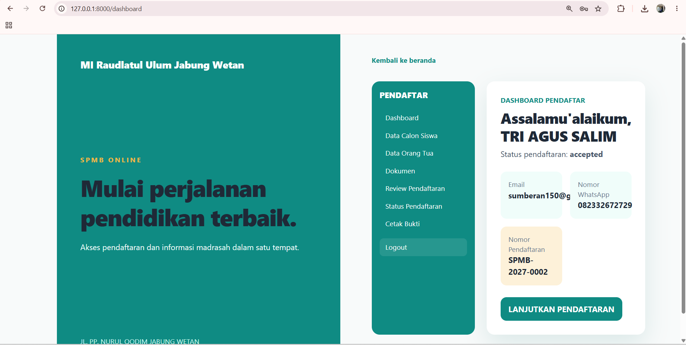

# Website Profil Madrasah + Sistem SPMB Online

## Deskripsi

Aplikasi Laravel untuk mengelola website profil madrasah dan Sistem Penerimaan Murid Baru (SPMB) online. Konten website dikelola melalui dashboard admin, sedangkan calon murid dapat mendaftar, mengisi formulir, mengunggah berkas, dan memantau status pendaftaran.

Dokumentasi ini mengikuti implementasi dalam repository. Data madrasah yang tersedia belum seluruhnya terverifikasi sebagai data resmi.

## Tujuan Project

- Menyediakan informasi madrasah yang dapat diperbarui melalui CMS.
- Memudahkan pendaftaran murid baru dan pengumpulan dokumen.
- Membantu admin melakukan verifikasi, meminta revisi, dan menetapkan hasil pendaftaran.
- Menyediakan bukti pendaftaran PDF, verifikasi QR Code, serta laporan CSV.

## Fitur Utama

- Profil madrasah, guru, program unggulan, prestasi, dan ekstrakurikuler.
- Hero/Banner CMS dengan banner gabungan desktop dan banner mobile opsional.
- Kegiatan siswa beserta galeri, berita, pengumuman, dan album galeri.
- Kontak, media sosial, serta pengaturan identitas website.
- Registrasi dan login pendaftar, formulir SPMB, dan unggah dokumen.
- Verifikasi, revisi, penerimaan/penolakan, dan riwayat status.
- Bukti PDF, QR Code, laporan, serta export CSV.
- Pengelolaan periode, gelombang SPMB, dan akun admin.

## Website Publik

| Halaman                              | Alamat                                                        |
| ------------------------------------ | ------------------------------------------------------------- |
| Homepage                             | /                                                             |
| Profil, sejarah, visi-misi, sambutan | /profil, /profil/sejarah, /profil/visi-misi, /profil/sambutan |
| Guru                                 | /guru                                                         |
| Program unggulan                     | /program-unggulan                                             |
| Prestasi                             | /prestasi                                                     |
| Ekstrakurikuler                      | /ekstrakurikuler                                              |
| Kegiatan siswa dan detail            | /kegiatan, /kegiatan/{slug}                                   |
| Berita dan detail                    | /berita, /berita/{slug}                                       |
| Pengumuman                           | /pengumuman                                                   |
| Galeri dan album                     | /galeri, /galeri/{slug}                                       |
| Kontak                               | /kontak                                                       |
| Verifikasi bukti SPMB                | /verifikasi-spmb/{token}                                      |

Berita dan kegiatan ditampilkan sesuai status serta waktu publikasinya. Tautan media sosial aktif ditampilkan melalui data CMS. Halaman struktur organisasi masih berupa kondisi data kosong; halaman kurikulum masih berupa informasi statis yang perlu diverifikasi.

Hero mengambil data database. Banner gabungan memuat desain latar dan ilustrasi dalam satu gambar; judul, tahun pelajaran, deskripsi, serta tombol tetap dikelola sebagai teks melalui CMS. Rekomendasi desain desktop 1920 x 720 piksel dan mobile 768 x 960 piksel. Sisakan ruang teks di kanan pada desktop dan di bawah pada mobile. Tampilan responsif dapat memotong bagian tepi gambar.

## Sistem SPMB

1. Pendaftar membuat akun di /register dan masuk melalui /login.
2. Mengisi biodata di /dashboard/biodata dan data orang tua di /dashboard/orang-tua.
3. Mengunggah berkas di /dashboard/dokumen.
4. Memeriksa data di /dashboard/review dan mengirim pendaftaran.
5. Memantau hasil dan catatan admin di /dashboard/status.
6. Memperbaiki data ketika diminta revisi, lalu mengirim ulang.
7. Melihat dan mengunduh bukti pendaftaran PDF dengan QR Code.

Dokumen wajib meliputi foto calon murid, kartu keluarga, dan akta kelahiran. Dokumen tambahan tersedia untuk KTP orang tua, ijazah TK, serta dokumen pendukung. Foto menerima JPG/JPEG/PNG; dokumen lainnya menerima PDF/JPG/JPEG/PNG, maksimal 2 MB per berkas.

Status yang digunakan: draft, submitted, under_review, revision, verified, accepted, dan rejected. Pendaftar dapat mengubah data ketika draft atau revisi. Admin memberikan catatan untuk revisi atau penolakan.

Pengiriman pendaftaran memerlukan periode dan gelombang aktif yang sesuai tanggal pendaftaran. Kuota dapat dicatat melalui admin; jangan menganggapnya sebagai penerimaan otomatis atau pembatasan kuota otomatis.

## Dashboard Admin

Masuk melalui /login menggunakan akun admin aktif, kemudian akses /admin.

- Ringkasan jumlah pendaftar, pendaftaran menunggu verifikasi, diterima, berita, kegiatan, guru, serta album galeri.
- Daftar pendaftar dan pengelolaan status, catatan, dokumen, serta PDF.
- CMS profil madrasah, guru, program, prestasi, ekstrakurikuler, berita, pengumuman, dan galeri.
- CMS kegiatan siswa dengan unggah banyak gambar, caption, urutan, serta gambar sampul.
- Hero/Banner di /admin/hero: teks, tahun pelajaran, tombol, status aktif, banner desktop, dan mobile opsional.
- Unggah hero JPG/JPEG/PNG/WEBP maksimal 2 MB per gambar, disimpan menggunakan nama unik pada prefix `hero/` di disk `public` (lokal atau Supabase S3 sesuai konfigurasi).
- Pengelolaan kontak, media sosial, logo, favicon, identitas, footer, dan warna website.
- Pengelolaan periode serta gelombang melalui /admin/spmb/periode dan /admin/spmb/gelombang.
- Laporan dan export CSV melalui /admin/spmb/laporan.
- Manajemen akun admin melalui /admin/pengguna, khusus super admin.

Banner desktop digunakan sebagai fallback jika banner mobile belum diunggah. Perubahan konten yang disimpan dibaca kembali oleh homepage.

## Role Pengguna

| Role        | Hak akses                                                                                                     |
| ----------- | ------------------------------------------------------------------------------------------------------------- |
| super_admin | Seluruh modul admin, termasuk membuat, mengubah, menonaktifkan akun admin dan mereset passwordnya.            |
| admin       | Mengelola konten website, pendaftaran, periode, gelombang, dan laporan; tidak mengakses manajemen akun admin. |
| pendaftar   | Mengelola pendaftaran sendiri, dokumen, status, serta bukti pendaftaran.                                      |

Pengunjung tanpa login dapat membuka website publik dan halaman verifikasi QR. Akun admin/super admin yang tidak aktif ditolak saat login dan mengakses area admin.

## Teknologi yang Digunakan

- Laravel 9 (versi terkunci 9.52.22), PHP sesuai `composer.lock`.
- Blade, Tailwind CSS 3, Alpine.js 3, Vite 4, dan Node.js 22.x.
- Supabase PostgreSQL untuk production; MySQL tetap didukung untuk pengembangan lokal.
- Supabase Storage melalui Flysystem S3 dan AWS SDK; nama disk aplikasi tetap `public` dan `spmb`.
- Laravel session authentication dengan middleware role.
- Laravel Dompdf untuk PDF dan BaconQrCode 2.0.8 untuk QR Code SVG.
- PHPUnit 9; SQLite untuk fixture pengujian lokal.
- Vercel dengan runtime komunitas `vercel-php@0.6.2`; target runtime PHP 8.2.20.

Gunakan `composer install` dan `npm ci` agar versi mengikuti lockfile. Simple QRCode sudah diganti dengan renderer SVG langsung; fitur PDF/logo production dirancang berjalan tanpa extension GD.

## Persyaratan Sistem

- Composer dan PHP yang memenuhi seluruh dependency dalam `composer.lock`; deklarasi aplikasi adalah `^8.0.2`, bukan jaminan semua versi PHP terbaru kompatibel.
- Production Vercel ditargetkan pada PHP 8.2.20; guard project menerima PHP 8.2.x.
- Extension yang diperiksa guard Vercel: `pdo_pgsql`, `xmlwriter`, `mbstring`, `fileinfo`, `dom`, dan `openssl`. Kebutuhan platform dependency lainnya tetap diperiksa Composer.
- PDO MySQL bila memakai MySQL lokal; PDO SQLite untuk suite pengujian lokal.
- GD tidak diwajibkan oleh jalur PDF/QR production. PNG/WebP asli untuk website tetap disimpan; PDF memakai JPEG yang disiapkan melalui CMS.
- Node.js 22.x dan npm; akses database serta bucket Storage yang sesuai lingkungan.
- Lokal: `storage/` dan `bootstrap/cache/` dapat ditulis; document root mengarah ke `public/`.
- Vercel: entrypoint `api/index.php`, direktori sementara untuk cache/view/font; media dan dokumen persisten berada di Supabase, sesi dan cache memakai database.

Periksa platform pada mesin yang benar-benar menjalankan aplikasi:

```powershell
php -v
composer check-platform-reqs --no-dev
```

PHP lokal yang tercatat pada audit sebelumnya adalah 8.0.30. Hasil tes lokal tidak otomatis membuktikan kompatibilitas runtime Vercel.

## Instalasi Project

Gunakan repository yang sudah ada, lalu jalankan dari direktori yang berisi file artisan. Tidak perlu membuat project Laravel baru.

```powershell
composer install
npm ci
```

Jika .env belum ada, salin contoh konfigurasi. Jangan menimpa .env instalasi yang sudah berjalan.

```powershell
Copy-Item .env.example .env
```

Setelah mengisi .env, buat application key hanya untuk instalasi baru:

```powershell
php artisan key:generate
```

Jangan mengganti APP_KEY pada instalasi existing karena dapat memengaruhi data terenkripsi dan sesi. Lanjutkan dengan konfigurasi database, migration, seeder yang sesuai, serta storage link di bawah.

## Konfigurasi .env

Contoh untuk pengembangan lokal; sesuaikan kredensial database dengan lingkungan masing-masing:

```dotenv
APP_NAME="Website Profil Madrasah + Sistem SPMB Online"
APP_ENV=local
APP_KEY=
APP_DEBUG=true
APP_URL=http://127.0.0.1:8000

DB_CONNECTION=mysql
DB_HOST=127.0.0.1
DB_PORT=3306
DB_DATABASE=web_profil_miru
DB_USERNAME=root
DB_PASSWORD=

FILESYSTEM_DISK=local
QUEUE_CONNECTION=sync
SESSION_DRIVER=file
CACHE_DRIVER=file
MAIL_MAILER=log
```

APP_KEY diisi oleh perintah key:generate. Unggahan modul menggunakan disk public secara eksplisit meskipun default FILESYSTEM_DISK adalah local. MAIL_MAILER=log cocok untuk pemeriksaan email lokal.

Untuk bootstrap super admin tanpa data demo, ProductionSeeder membaca variabel berikut. Isi sendiri melalui .env lokal server; password sengaja tidak dicantumkan.

```dotenv
SCHOOL_NAME="Nama Madrasah"
INITIAL_SUPER_ADMIN_NAME=
INITIAL_SUPER_ADMIN_EMAIL=
INITIAL_SUPER_ADMIN_PASSWORD=
```

Nama wajib diisi, email harus valid dan unik, serta password minimal 12 karakter. Variabel akun hanya dibutuhkan jika belum ada super admin. Hapus rahasia bootstrap dari konfigurasi setelah akun berhasil dibuat.

Untuk production, gunakan APP_ENV=production, APP_DEBUG=false, APP_URL domain HTTPS sebenarnya, dan kredensial server yang sesuai. Jangan commit .env atau rahasia ke repository.

### Konfigurasi production Vercel dan Supabase

Simpan nilai asli melalui Environment Variables Vercel, bukan README, JavaScript, atau Git. Jangan mengganti `APP_KEY` existing. `.env` dan `.env.supabase` harus tetap privat.

```dotenv
APP_ENV=production
APP_DEBUG=false
APP_URL=https://domain-aplikasi.example
DB_CONNECTION=pgsql
DB_PORT=6543
DB_SSLMODE=require
DB_EMULATE_PREPARES=true
SESSION_DRIVER=database
CACHE_DRIVER=database
QUEUE_CONNECTION=sync
FILESYSTEM_DISK=s3
PUBLIC_FILESYSTEM_DRIVER=s3
SPMB_FILESYSTEM_DRIVER=s3
AWS_USE_PATH_STYLE_ENDPOINT=true
AWS_BUCKET=media
AWS_PRIVATE_BUCKET=documents
```

Contoh port `6543` berlaku untuk transaction pooler; gunakan host, port, username, dan region yang benar dari dashboard Supabase. Isi `DB_HOST`, `DB_DATABASE`, `DB_USERNAME`, `DB_PASSWORD`, `AWS_ACCESS_KEY_ID`, `AWS_SECRET_ACCESS_KEY`, `AWS_DEFAULT_REGION`, `AWS_ENDPOINT`, serta `AWS_URL` secara privat. Guard juga mewajibkan `APP_KEY` dan URL HTTPS. Jangan menyalin nilai contoh sebagai credential.

`AWS_ENDPOINT` adalah endpoint S3; `AWS_URL` adalah base URL REST publik bucket media, bukan endpoint S3 atau URL bucket dokumen. Project memiliki compatibility layer endpoint; jangan menambahkan path S3 dua kali. Akun database dan credential S3 berbeda.

`api/index.php` menyiapkan direktori sementara dan marker Vercel. `config/app.php` membaca `env('VERCEL', false)`; Handler mengaktifkan diagnostik aman pada Vercel, sementara perilaku Laravel biasa dipertahankan di luar Vercel. Jangan menyalakan debug publik untuk investigasi.

Reset password memerlukan pengiriman email yang dikonfigurasi; `MAIL_MAILER=log` hanya untuk lokal dan tidak mengirim email ke pengguna.

## Setup Database

Production menggunakan Supabase PostgreSQL yang sudah tersedia. Jangan membuat ulang atau mereset database existing. Konfigurasi MySQL berikut hanya pilihan untuk instalasi lokal baru:

```sql
CREATE DATABASE web_profil_miru
    CHARACTER SET utf8mb4
    COLLATE utf8mb4_unicode_ci;
```

Sesuaikan DB_DATABASE, DB_USERNAME, dan DB_PASSWORD pada .env. Untuk database existing, gunakan database tersebut dan lakukan backup sebelum perubahan skema.

Seeder default memanggil ProductionSeeder, yang membuat profil minimal dan super admin awal tanpa memasukkan konten demo:

```powershell
php artisan db:seed
```

Jalankan setelah migration. Alternatif eksplisit yang setara:

```powershell
php artisan db:seed --class=ProductionSeeder
```

Seeder tidak mengganti kredensial super admin yang sudah ada.

Untuk development lokal yang membutuhkan contoh konten dan akun, gunakan pilihan berikut setelah migration:

```powershell
php artisan db:seed --class=DevelopmentSeeder
```

**DEVELOPMENT ONLY: jangan gunakan akun berikut untuk production.**

| Role        | Email                 | Password development |
| ----------- | --------------------- | -------------------- |
| Super admin | superadmin@mi-ru.test | spmb-dev-2026        |
| Admin       | admin@mi-ru.test      | spmb-dev-2026        |

Akun tersebut hanya tersedia jika DevelopmentSeeder dijalankan. Seeder menggunakan firstOrCreate sehingga password akun existing tidak ditimpa. DevelopmentSeeder hanya berjalan pada lingkungan local/testing.

Periode dan gelombang demo dibuat tidak aktif. Atur tanggal dan aktifkan melalui admin sebelum mencoba pengiriman pendaftaran.

## Migration

Jalankan migration tambahan tanpa menghapus data:

```powershell
php artisan migrate
php artisan migrate:status
```

Migration mencakup tabel konten CMS, hero/banner, pengguna, pendaftaran, dokumen, periode, dan gelombang. Jangan menggunakan migrate:fresh, db:wipe, atau reset database pada instalasi existing.

## Storage Link

Untuk disk lokal saja, hubungkan media publik:

```powershell
php artisan storage:link
```

Disk `public` lokal memakai `storage/app/public`; disk privat `spmb` memakai `storage/app/private` dengan prefix dokumen `spmb/`. Dokumen hanya dilayani melalui route yang memeriksa login, role, dan kepemilikan.

Pada Vercel, gunakan driver S3 untuk kedua disk. Konfigurasi production memakai bucket `media` yang public dan `documents` yang private, melalui `AWS_BUCKET` dan `AWS_PRIVATE_BUCKET`. Object key di database tetap relatif. URL media menggunakan disk `public`; dokumen privat di-stream melalui aplikasi, bukan URL publik. `/storage/*` diblokir pada routing Vercel; `storage:link` bukan mekanisme penyimpanan cloud.

Untuk endpoint, URL publik, dan pemindahan file lama, lihat [setup Storage](docs/SUPABASE_STORAGE_SETUP.md) dan [hasil finalisasi Supabase](docs/FINALISASI_SUPABASE_2026-11-14.md). Dokumen setup lama memuat contoh nama bucket; gunakan nama bucket aktual, serta penjelasan JPEG PDF terbaru di bawah.

`spmb:privatize-documents` hanya untuk migrasi dokumen lokal lama setelah backup dan peninjauan. Perintah ini dapat menghapus salinan publik setelah verifikasi; jangan digunakan sebagai alat transfer cloud.

### Logo website dan logo PDF tanpa GD

Website mempertahankan logo PNG/JPEG/WebP asli. CMS Profil Madrasah dan Pengaturan Website menyiapkan JPEG khusus PDF melalui Canvas browser, dengan latar putih dan proporsi asli. Admin wajib memeriksa preview sebelum menyetujui. JPEG input dipakai langsung; PNG/WebP memerlukan pasangan JPEG. JPEG bersifat lossy dan tidak menyimpan transparansi; file asli website tetap dipertahankan.

Untuk logo lama, buka CMS dan gunakan tombol persiapan JPEG logo saat ini. Jangan menghapus sumber lama. Periksa kesiapan logo aktif secara read-only:

```powershell
php artisan spmb:check-pdf-logo
```

Bukti pendaftar dan PDF admin memakai template yang sama serta QR SVG. Lihat [implementasi dan pengujian logo tanpa GD](docs/VERCEL_GDLESS_LOGO_2026-11-15.md).

## Menjalankan Vite

Jalankan pada terminal terpisah selama pengembangan:

```powershell
npm run dev
```

Untuk menghasilkan aset build:

```powershell
npm run build
```

Akses website melalui alamat Laravel. Server Vite menyediakan aset saat pengembangan; hasil build tersimpan di public/build/.

## Menjalankan Laravel

```powershell
php artisan serve
```

Alamat default:

- Website publik: http://127.0.0.1:8000
- Login: http://127.0.0.1:8000/login
- Dashboard admin: http://127.0.0.1:8000/admin
- Dashboard pendaftar: http://127.0.0.1:8000/dashboard

Gunakan dua terminal untuk Laravel dan Vite. Jika menggunakan port berbeda, sesuaikan APP_URL.

## Testing

Jalankan suite lokal pada lingkungan pengujian yang terpisah:

```powershell
php artisan test
```

Contoh regresi yang tersedia:

```powershell
php artisan test --filter=HeroBannerTest
php artisan test --filter=SpmbRegressionTest
php artisan test --filter=PdfLogoUploadTest
php artisan test --filter=GdlessApplicationProofTest
php artisan test --filter=PostgresBooleanBindingTest
php artisan test --filter=VercelRoutingTest
php artisan test --filter=SafeExceptionDiagnosticTest
php artisan test --filter=VercelDiagnosticFlagTest
composer validate --no-check-publish
composer check-platform-reqs --no-dev
php artisan route:list
npm run build
```

`phpunit.xml` menjalankan direktori Unit dan Feature; tes Integration live tidak termasuk suite default. Fixture fitur menggunakan database terisolasi, tetapi konfigurasi database global SQLite pada `phpunit.xml` masih dikomentari. Periksa isolasi lingkungan sebelum menjalankan tes; jangan mengarahkan suite umum ke database production.

Tes live Supabase memerlukan opt-in eksplisit dan `.env.supabase` privat. Baca prosedur serta batas isolasinya sebelum menjalankan:

- `tests/Integration/SupabaseStorageTest.php`: upload, exists, baca media publik, penolakan akses publik dokumen privat, dan delete hanya objek tes dengan prefix acak.
- `tests/Integration/PostgresBooleanIntegrationTest.php`: temporary tables dalam transaksi dengan rollback; tidak menjalankan migration atau menulis record aplikasi production.
- [Laporan Boolean PostgreSQL](docs/POSTGRES_BOOLEAN_COMPATIBILITY_2026-11-15.md) dan [laporan logo/Supabase](docs/VERCEL_GDLESS_LOGO_2026-11-15.md) memuat hasil pengujian terdahulu, bukan hasil tes yang dijalankan ulang saat README diperbarui.

Uji manual meliputi login per role, edit CMS lalu cek homepage, upload dokumen, submit/revisi/verifikasi, hasil diterima/ditolak, PDF dengan logo, pemindaian QR, export CSV, dan tampilan mobile. Gunakan data uji dan periode/gelombang yang valid.

## Struktur Folder Singkat

```text
app/
  Database/             Compatibility layer koneksi PostgreSQL
  Providers/            Registrasi layanan dan binding PostgreSQL
  Support/              QR SVG, logo PDF, runtime dan diagnostik Vercel
  Http/Controllers/     Controller publik, autentikasi, pendaftar, dan admin
  Http/Middleware/      Pembatasan akses termasuk role
  Models/               Model CMS dan SPMB
database/
  migrations/           Perubahan skema database
  seeders/              Bootstrap minimal dan data demo terpisah
docs/                   Audit, checklist, dan dokumentasi pendukung
api/index.php           Entrypoint Laravel pada Vercel
vercel.json             Konfigurasi runtime dan routing deployment
scripts/vercel-check.php Pemeriksaan platform dan konfigurasi build
public/                 Document root lokal serta aset publik
resources/
  views/                Blade publik, admin, dan dashboard pendaftar
  css/                  Stylesheet
  js/                   JavaScript
routes/web.php          Route aplikasi
storage/app/public/     Penyimpanan unggahan
tests/Feature/          Pengujian fitur
tests/Unit/             Regresi platform, routing, PDF, dan binding
tests/Integration/      Tes live Supabase dengan opt-in eksplisit
tests/Browser/          Harness Canvas logo dan bukti PDF
```

## Status Project

Dokumentasi diperbarui 16 November 2026 berdasarkan implementasi repository. Modul utama website publik, CMS, dan SPMB sudah tersedia. Deployment Vercel pernah dilaporkan Ready; status Ready tidak membuktikan seluruh halaman dan alur production sudah lolos uji. Perubahan terbaru tetap memerlukan smoke test setelah deployment yang disetujui pemilik.

Penyempurnaan deployment yang sudah ada dalam kode:

- Entrypoint Laravel `api/index.php` dan routing root eksplisit sebelum aset statis. Request PHP publik, dotfile, dan storage lokal ditolak; aset aman diizinkan secara eksplisit tanpa `filesystem` catch-all.
- Disk S3 publik/privat terpisah dan penanganan endpoint Supabase yang terduplikasi.
- QR SVG dan pasangan JPEG logo PDF untuk runtime tanpa GD.
- Diagnostik exception aman di Vercel Runtime Logs tanpa menampilkan stack/error mentah pada pengguna.
- Compatibility layer Boolean khusus PostgreSQL agar binding true/false valid; MySQL tidak diubah dan vendor tidak dipatch.

Panduan pendukung:

- [Deployment Vercel + Supabase](docs/VERCEL_SUPABASE_DEPLOYMENT.md), [setup database](docs/SUPABASE_SETUP.md), dan [checklist deployment](docs/DEPLOYMENT_CHECKLIST.md).
- [Perbaikan routing](docs/VERCEL_ROUTING_FIX_2026-11-15.md).
- [Diagnostik exception](docs/VERCEL_EXCEPTION_DIAGNOSTICS_2026-11-15.md).
- [Kompatibilitas Boolean PostgreSQL](docs/POSTGRES_BOOLEAN_COMPATIBILITY_2026-11-15.md).
- [Logo PDF tanpa GD](docs/VERCEL_GDLESS_LOGO_2026-11-15.md).

Dokumen audit bertanggal menggambarkan kondisi saat audit; beberapa panduan awal masih menyebut rancangan lama. Konfigurasi dan implementasi terkini menjadi acuan utama.

Finalisasi data resmi, pengujian production, dan penanganan advisory dependency masih perlu ditinjau. Lihat [catatan keamanan dependency](docs/SECURITY_DEPENDENCY_UPGRADE_2026-10-19.md) serta [hasil audit tersimpan](docs/security-audit/after.json); file audit tersebut bukan audit baru pada tanggal pembaruan README. Dokumentasi ini tidak menyatakan aplikasi bebas kerentanan.

Struktur organisasi belum memiliki data resmi dan kurikulum masih statis; keduanya belum boleh dianggap sebagai CMS lengkap.

## Catatan Data Demo dan Data Resmi

Belum ada sumber data resmi madrasah yang diberikan untuk finalisasi. Nama, kontak, alamat, profil, guru, prestasi, jadwal, dan konten existing harus diperiksa pemilik madrasah sebelum dinyatakan resmi.

- Data demo hanya untuk pengembangan dan pengujian.
- Seeder default tidak memasukkan konten demo; DevelopmentSeeder merupakan pilihan terpisah.
- Record existing dipertahankan; jangan menghapusnya otomatis hanya karena belum terverifikasi.
- Beberapa placeholder disaring dari tampilan publik, tetapi penyaringan tersebut tidak menggantikan pemeriksaan data resmi.
- Tinjau dan ganti konten melalui CMS berdasarkan dokumen resmi yang disetujui.

Gunakan [checklist data sekolah](docs/DATA_SEKOLAH_CHECKLIST.md) dan [audit data sekolah](docs/AUDIT_DATA_SEKOLAH.md) sebagai panduan finalisasi.

## PRD - Product Requirements Document

### Ringkasan produk dan masalah

**Produk:** Website Profil Madrasah + Sistem SPMB Online untuk MI Raudlatul Ulum Jabung Wetan. Informasi madrasah dan pendaftaran dikelola dalam satu aplikasi agar pengunjung mendapat informasi, pendaftar dapat melengkapi berkas, dan petugas dapat memproses pendaftaran secara terstruktur.

PRD ini mendokumentasikan perilaku existing dan kriteria penerimaannya. Kriteria di bawah merupakan acuan verifikasi, bukan klaim seluruhnya sudah diuji pada deployment production terbaru.

### Sasaran pengguna

| Pengguna | Kebutuhan |
| --- | --- |
| Pengunjung/orang tua | Membaca profil, program, berita, kegiatan, kontak, dan informasi pendaftaran. |
| Pendaftar | Membuat akun, mengisi data, mengunggah dokumen, mengikuti revisi, memantau status, dan mengunduh bukti. |
| Admin | Memperbarui konten, memeriksa dokumen, mencatat keputusan, mengatur periode/gelombang, dan mengekspor laporan. |
| Super admin | Menjalankan seluruh tugas admin serta mengelola akses akun admin. |

### Ruang lingkup dan kriteria penerimaan

| ID | Kebutuhan tersedia | Kriteria penerimaan |
| --- | --- | --- |
| FR-01 | Website profil dan CMS konten | Konten yang disimpan dan memenuhi status publik tampil pada halaman publik terkait; kondisi kosong ditangani. |
| FR-02 | Hero/Banner CMS | Teks, tahun pelajaran, tombol, status aktif, banner desktop dan mobile opsional dapat diubah; homepage membaca database dengan fallback. |
| FR-03 | Identitas, kontak, media sosial | Perubahan CMS ditampilkan pada lokasi yang memakai data tersebut; hanya media sosial aktif yang ditampilkan. |
| FR-04 | Registrasi dan autentikasi | Akun pendaftar dapat login; dashboard mengikuti role; admin nonaktif ditolak; tautan reset memerlukan mailer yang berfungsi. |
| FR-05 | Formulir dan dokumen SPMB | Pendaftar mengelola data miliknya; validasi tipe/ukuran file berlaku; berkas privat tidak dapat dibuka oleh pihak tanpa izin. |
| FR-06 | Submit dan periode/gelombang | Pengiriman memerlukan data wajib serta periode/gelombang aktif sesuai tanggal; pendaftar dapat mengedit ketika draft/revisi. |
| FR-07 | Verifikasi dan hasil | Admin memproses status sesuai transisi existing; catatan revisi/penolakan dan riwayat dapat dilihat sesuai hak akses. |
| FR-08 | Bukti PDF dan QR | PDF pendaftar/admin menampilkan data, logo proporsional, dan QR SVG menuju URL verifikasi existing; tidak membutuhkan GD. |
| FR-09 | Laporan dan export | Admin dapat memfilter laporan dan mengekspor CSV sesuai implementasi; akses dibatasi role. |
| FR-10 | Manajemen admin | Hanya super admin mengakses pembuatan, perubahan, penonaktifan, dan reset password akun admin. |

### Alur utama

Pengunjung membaca informasi -> registrasi/login -> melengkapi biodata dan orang tua -> upload dokumen -> review dan submit -> pemeriksaan admin -> revisi bila diperlukan -> verifikasi/keputusan -> pemantauan status dan unduh bukti. Status teknis mengikuti bagian Sistem SPMB; PRD ini tidak menambahkan atau mengubah transisi bisnis.

### Kebutuhan nonfungsional dan batas implementasi

- **Akses dan privasi:** gunakan middleware role, pemeriksaan pemilik dokumen, bucket privat, CSRF, validasi server, dan HTTPS production. Credential tidak dimasukkan ke dokumentasi atau frontend.
- **Kompatibilitas:** Laravel 9, PHP Vercel 8.2.20, PostgreSQL Boolean asli, dan S3; pemeriksaan platform Composer tetap dijalankan tanpa memalsukan extension.
- **Penyimpanan:** media persisten di bucket publik, dokumen di bucket privat; filesystem sementara Vercel bukan penyimpanan permanen.
- **PDF:** logo asli dipertahankan untuk website; pasangan JPEG berlatar putih disetujui melalui preview admin untuk PDF. QR tetap SVG dengan payload existing.
- **Antarmuka:** halaman publik, login, pendaftar, dan admin harus diperiksa pada desktop/mobile. Lihat [audit responsif](docs/AUDIT_RESPONSIVE_2026-11-09.md); audit terdahulu tidak menggantikan uji versi terbaru.
- **Observabilitas:** HTTP 500 tetap 500; diagnostik teknis aman tersedia pada Vercel tanpa merekam credential atau data pribadi pengguna.
- **Kapasitas:** upload mengikuti validasi aplikasi dan batas payload runtime; unggah banyak gambar dalam batch kecil. Belum ada klaim SLA, kapasitas pengguna bersamaan, atau benchmark production.

### Di luar fitur yang sudah tersedia

Pembayaran online, notifikasi WhatsApp otomatis, seleksi otomatis, penerimaan otomatis berdasarkan kuota, dan CMS struktur organisasi/kurikulum lengkap tidak dinyatakan sebagai fitur tersedia. Permintaan tersebut memerlukan lingkup dan persetujuan terpisah.

### Verifikasi sebelum penggunaan operasional

1. Pemilik madrasah memvalidasi data resmi dan mengatur periode/gelombang.
2. Uji akses tiap role, isolasi dokumen, dan pembatasan akun nonaktif.
3. Uji CMS, logo, media S3, dan tampilan responsif di production.
4. Uji submit, revisi, verifikasi, keputusan, export, PDF, serta scan QR memakai data uji.
5. Periksa Runtime Logs, kesiapan mailer reset password, backup/pemulihan, dan advisory dependency.

Keberhasilan produk dinilai dari kelengkapan konten resmi, kemampuan pendaftar menyelesaikan alur, ketepatan keputusan/status, dan akses dokumen sesuai izin. Target angka dan evaluasi operasional perlu ditetapkan pemilik madrasah; belum ada metrik terukur yang diklaim di sini.

## Screenshot

### Homepage


### Dashboard Admin



### Dashboard Pendaftar



### Halaman SPMB



## Author / Pengembang

TRI AGUS SALIM | 2321400036 |TEKNIK INFORMATIKA
